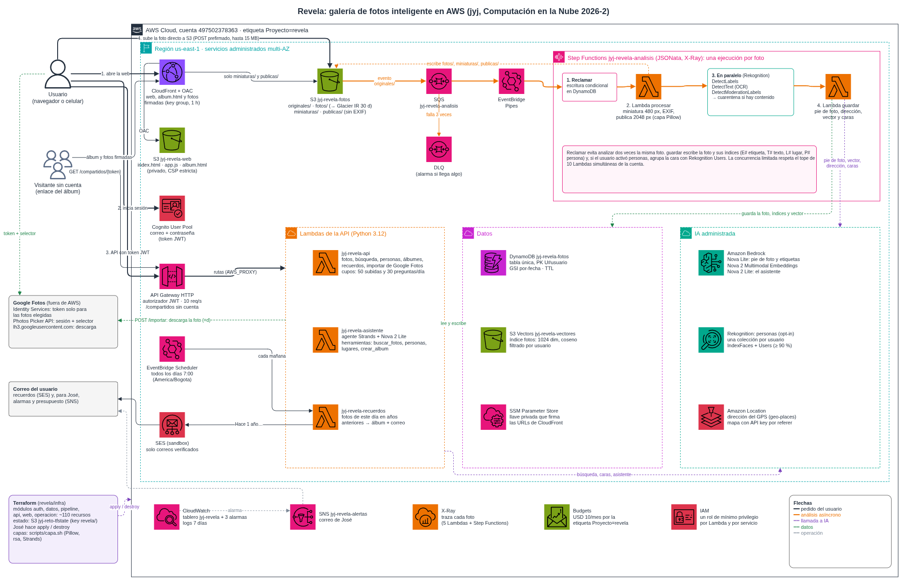

# Revela — galería de fotos inteligente en AWS

Trabajo final de Computación en la Nube (2026-2), de [José Andrés Daza Gallego](https://github.com/FoxyYTs) y [Juliana Castañeda Ramírez](https://github.com/Juliana61). Una galería de fotos tipo Google Fotos, sin
servidores: cuentas con Cognito, subida directa a S3, análisis en paralelo con Step Functions (etiquetas, OCR,
moderación, miniatura + EXIF), pie de foto con Nova, lugares con Amazon Location, búsqueda por significado con
S3 Vectors, personas con Rekognition, álbumes compartidos por CloudFront, un asistente con Strands y recuerdos
diarios por correo. Todo se crea y se destruye con Terraform.

```
Navegador ──Cognito (login)──► API Gateway HTTP (JWT) ──► Lambda api ──► DynamoDB
    │                                                        │
    └──POST prefirmado──► S3 originales/ ──► SQS ──► EventBridge Pipes ──► Step Functions
                                                                          1. Reclamar (DynamoDB, una vez por foto)
                                                                          2. Lambda procesar (miniatura + EXIF, copia a fotos/)
                                                                          3. En paralelo sobre fotos/:
                                                                             ├─ Rekognition DetectLabels
                                                                             ├─ Rekognition DetectText
                                                                             └─ Rekognition DetectModerationLabels
                                                                          4. Lambda guardar (Nova Lite: pie de foto + traducción;
                                                                             Amazon Location: dirección del GPS) ──► DynamoDB
                                                                             Nova Multimodal Embeddings ──► S3 Vectors
                                                                             Rekognition IndexFaces + Users (si activó personas)
Web: S3 privado ◄── CloudFront + OAC          Mapa: MapLibre + mosaicos de Amazon Location (API key solo para la web)
     album.html ──► GET /compartidos/{token} (sin cuenta) ──► URLs de CloudFront firmadas (key group) ──► publicas/ y miniaturas/
     EventBridge Scheduler (7:00 Colombia) ──► Lambda recuerdos ──► álbum «Recuerdos del …» + correo con SES
     ✦ Preguntar ──► POST /asistente ──► Lambda asistente (Strands + Nova 2 Lite) ──► herramientas sobre api.py
```

Diagrama completo: [`docs/arquitectura-revela.drawio`](docs/arquitectura-revela.drawio) (se abre en app.diagrams.net) y su
imagen:



| Carpeta | Contenido |
|---|---|
| `lambdas/` | `api.py`, `asistente.py`, `recuerdos.py`, `procesar.py`, `guardar.py`, `caras.py` y `test_flujo.py` (moto) |
| `web/` | `index.html` + `app.js`, sin build; la configuración llega en `config.js` (la escribe Terraform) |
| `infra/` | Terraform: módulos `auth`, `datos`, `pipeline`, `api`, `web`, `operacion` (109 recursos) |
| `docs/` | Diagrama de arquitectura en draw.io y PNG |
| `scripts/capa.sh` | Construye las capas (Pillow, rsa, Strands); Terraform la llama sola |

## Pruebas

```bash
uv venv .venv -p 3.12 && uv pip install -p .venv boto3 "moto[s3,dynamodb]" pillow pytest
cd lambdas && ../.venv/bin/pytest -q
```

## Despliegue

Necesita `uv` y `zip` (para las capas de Pillow y rsa). Estado en `jyj-reto-tfstate-497502378363`, key `revela/`.
El correo de las alarmas va en `infra/terraform.tfvars` (ignorado por git): `correo_alertas = "tu@correo.com"`.
Después del primer apply llega un correo de SNS para confirmar la suscripción.

```bash
cd infra
terraform init
terraform apply
terraform output web_url
```

Probar la página en local contra la API real: `terraform output -raw config_js > ../web/config.js`
y `cd ../web && python -m http.server 8000` (localhost:8000 está permitido en CORS).

Destruir: `terraform destroy` (los buckets tienen `force_destroy`) y `scripts/borrar_caras.sh` (las colecciones de
caras las crea la API, no Terraform). El destroy también desactiva la etiqueta de costos `Proyecto` en Billing.

## Asistente (`lambdas/asistente.py`)

El botón **✦ Preguntar** del buscador manda la frase a un agente de **Strands Agents** con **Amazon Nova 2 Lite**
(`us.amazon.nova-2-lite-v1:0`). El agente decide qué herramientas usar y responde en una a tres frases. Las fotos que
encontró aparecen debajo, como en cualquier búsqueda, y se pueden pasar a un álbum.

| Herramienta | Qué hace |
|---|---|
| `buscar_fotos(texto, personas, lugar, desde, hasta)` | Cruza los filtros que reciba: lo que se ve (búsqueda exacta + por significado), nombres de personas, ciudad y rango de fechas |
| `personas()` / `lugares()` | Nombres y ciudades que existen, para corregir lo que pidió el usuario |
| `crear_album(nombre)` | Guarda en un álbum la última búsqueda ("arma un álbum con…") |

- Corre en su propia Lambda con la capa `strands` (~72 MB), para que su arranque en frío no frene la API. Reutiliza
  las funciones de `api.py`.
- Las herramientas se crean en cada petición con el usuario del JWT ya puesto. El modelo no puede pedir fotos de otra
  persona y nunca maneja ids.
- Tope: 30 preguntas por usuario al día. En local responde en 2-3 s.
- **Conversación:** la Lambda no guarda nada. Mientras la conversación sigue abierta, la página manda los últimos 3
  turnos (pregunta y respuesta, solo texto) y los ids de las fotos en pantalla. Así se pueden contestar sus preguntas
  («sí») o pedir «haz un álbum con esas». Enter le responde al asistente; ← o una búsqueda normal la terminan.
- Si una búsqueda con varios filtros queda vacía, `buscar_fotos` le dice al modelo cuántas fotos da cada filtro por
  separado. Así propone algo concreto («Juliana sale en 2 fotos, pero ninguna en Medellín»).

## Importar de Google Fotos (Picker API)

En los ajustes, **Importar de Google Fotos…** abre el selector oficial de Google Fotos. Revela solo ve las fotos que el
usuario elige: Google retiró en 2025 el acceso a la biblioteca completa.

1. La página pide un token de Google (Google Identity Services, permiso `photospicker.mediaitems.readonly`).
2. Con ese token crea una sesión del selector, el usuario abre Google Fotos y elige, y la página espera a que la
   sesión diga `mediaItemsSet`.
3. Por cada foto, `POST /importar {token, url, nombre, fecha}`. La API la descarga (`baseUrl=d`) y la deja en `originales/`
   con el mismo cupo y el mismo análisis de una subida normal. `fecha` es el `createTime` de Google: se usa si el
   archivo no trae fecha EXIF (fotos de WhatsApp). La descarga no la puede hacer el navegador porque
   Google no permite CORS con `Authorization` en `lh3.googleusercontent.com`.
4. Al final la página borra la sesión.

- **Seguridad:** la API solo acepta URLs `https://lhN.googleusercontent.com/…` y no sigue redirecciones, así que el
  token de Google no puede terminar en otro host. Tampoco se guarda ni se registra en los logs.
- **Limitaciones:**
  - Google entrega las fotos **sin ubicación**: no salen en el mapa.
  - Solo se importan JPG y PNG: HEIC y videos no.
- **Configuración:** proyecto de Google Cloud con la Photos Picker API, pantalla de consentimiento en modo prueba
  (usuarios de prueba) y un ID de cliente OAuth web con los orígenes de CloudFront y `http://localhost:8000`. El ID va
  en `google_client_id` de `terraform.tfvars`; sin él, el botón no aparece.

## Recuerdos (`lambdas/recuerdos.py`)

Quien marca **Recibir recuerdos por correo** en los ajustes queda en la partición `RECUERDOS` de la tabla. Cada día a
las 7:00 (hora de Colombia), **EventBridge Scheduler** llama a la Lambda `jyj-revela-recuerdos`. Por cada usuario
suscrito:
1. Busca fotos de ese mismo día y mes en años anteriores.
2. Arma el álbum «Recuerdos del 5 de diciembre». Si ya existe uno con esas fotos, no lo repite.
3. Manda un correo con **SES** que dice «Hace 1 año…», con hasta 6 miniaturas firmadas por CloudFront durante 7 días y
   un enlace que abre esos recuerdos en la web (`/?recuerdos=AAAA-MM-DD`).

En la web, con o sin correo, los recuerdos salen en un carrusel arriba de la galería (`GET /recuerdos`). Cada colección
necesita al menos 3 fotos y se elige con una semilla por fecha, así que se mantienen todo el día y cambian al siguiente:

| Colección | De dónde sale |
|---|---|
| «Hace 1 año» | Este mismo día en años anteriores (la misma del correo) |
| «Rememorando el sábado» | El día con más fotos de la última semana |
| «¿Te acuerdas de este día?» | Un día de hace más de un mes |
| «Con Juliana» | Una persona con nombre (si activó personas) |
| «En Rionegro» | Una ciudad (Amazon Location) |
| «Selfies», «Para comer», «Perros»… | Etiquetas de Rekognition que dan para un tema |
 Para la demo, `/?recuerdos=2027-11-15` muestra cómo se verán dentro de un año las fotos del 15 de
noviembre de 2026; el mismo valor sirve como `fecha` en el `aws lambda invoke`.

**SES está en sandbox:** solo entrega a correos verificados, hasta 200 al día. El `apply` crea la identidad de
`correo_alertas`, y AWS manda un correo de verificación que hay que confirmar. Ese correo funciona como remitente y
como destinatario. Para que le llegue a otra cuenta de Revela, su correo va en `correos_prueba = [...]` de
`terraform.tfvars`: el apply la registra en SES, le manda su propio correo de verificación y le da permiso a la Lambda
(en sandbox, SES autoriza también contra la identidad del destinatario). A los demás usuarios se les arma el álbum igual,
y el rechazo de SES queda en el log.

Para probar con otra fecha (por ejemplo, el día de la exposición):
```
aws lambda invoke --function-name jyj-revela-recuerdos --cli-binary-format raw-in-base64-out \
  --payload '{"fecha":"2026-12-05"}' /dev/stdout
```

## Operación (módulo `operacion` y ajustes en los demás)

- **Tablero de CloudWatch** `jyj-revela` (`terraform output tablero`): fotos analizadas y fallidas, segundos por foto
  (p50/p90), invocaciones/errores/throttles de las 5 Lambdas, peticiones y errores de la API, cola y DLQ, y llamadas a
  Rekognition y Bedrock. Estas dos últimas son de toda la cuenta, porque esos servicios no tienen recursos propios.
- **Alarmas por correo (SNS):** análisis fallido en Step Functions, mensajes en la DLQ y 5xx en la API. Sin tráfico no
  se disparan (`notBreaching`).
- **X-Ray:** Step Functions y las 5 Lambdas en modo `Active`. La traza sigue cada foto por el flujo. API Gateway HTTP
  no aparece porque X-Ray solo existe en las APIs REST.
- **Presupuesto (AWS Budgets):** USD 10 al mes, filtrado por la etiqueta `Proyecto=revela`, que Terraform activa en Billing
  y que tarda hasta 24 h en contar. Avisa al 50 % real y al 100 % proyectado. Rekognition, Bedrock y Location cobran por
  llamada y no llevan etiqueta: ese gasto lo acotan los cupos por usuario y el throttling de la API. Un presupuesto de
  toda la cuenta saltaría por el uso del resto del curso.
- **Ciclo de vida en S3:** `fotos/` (el archivo completo) pasa a Glacier Instant Retrieval a los 30 días; cuesta ~1/6
  y se lee al instante, con un cobro pequeño por GB leído. Miniaturas y `publicas/` se quedan en Standard. "Buscar caras"
  lee `publicas/` para no tocar el archivo de Glacier. Las subidas multiparte abandonadas se borran al día.

## Costos por cada mil fotos

Precios on-demand de us-east-1 sacados de la AWS Price List API (17/11/2026), sin capa gratuita (la cuenta es
compartida). Los consumos son medidos en las 50 fotos de prueba: `procesar` 0,81 s a 1024 MB, `guardar` 2,3 s a 256 MB,
Nova Lite 1730 tokens de entrada y 65 de salida por foto, y en S3 2,2 MB el archivo, 32 KB la miniatura y 340 KB la
copia pública.

**Analizar 1000 fotos (una sola vez):**

| Parte | Cálculo | USD |
|---|---|---|
| Rekognition | 3 llamadas (etiquetas, texto, moderación) × USD 1 por mil | 3,00 |
| Amazon Location | nombre del lugar guardado (`IntendedUse=Storage`): USD 4 por mil, solo fotos con GPS | hasta 4,00 |
| Bedrock, Nova Lite | 1,73 M tokens × USD 0,06/M + 65 mil × USD 0,24/M | 0,12 |
| Bedrock, embeddings | USD 0,06 por mil imágenes | 0,06 |
| Step Functions (Standard) | ~9 transiciones × USD 0,025 por mil | 0,23 |
| Lambda | 1,38 GB-s por foto × USD 0,0000167 | 0,02 |
| S3, DynamoDB, S3 Vectors, SQS, Pipes | ~4 PUT y ~5 GET en S3, ~30 escrituras en la tabla, un PUT de vector | 0,09 |
| **Total** | | **≈ 3,50 sin GPS, ≈ 7,50 con GPS** |

Personas (opt-in) suma `IndexFaces` por foto y `SearchUsers` + `AssociateFaces` por cara (`CreateUser` si es alguien
nuevo): con 2 caras por foto, unos USD 5 más por cada mil fotos.

**Guardar 1000 fotos al mes:** 2,2 GB de archivos a USD 0,023/GB el primer mes y USD 0,004/GB desde el día 30
(Glacier IR), más 0,37 GB de miniaturas y copias públicas en Standard. Son ≈ USD 0,06 el primer mes y ≈ USD 0,02 después.
DynamoDB (≈ 6,5 KB por foto), los vectores (4 KB) y las caras guardadas no llegan a un centavo.

**Usarla:** cada pedido a la API cuesta USD 1 por millón (más la Lambda, ~0,15 s a 256 MB); los mosaicos del mapa,
USD 0,04 por mil; una pregunta al asistente, ≈ USD 0,004 (Nova 2 Lite: medido ~10 mil tokens de entrada en ~6 llamadas
al modelo por pregunta); un correo de recuerdos, USD 0,0001. Fijos al mes: 3 alarmas a USD 0,10 y el tablero
(USD 3 si la cuenta ya usa sus 3 gratis). Cognito, Scheduler, SNS y CloudFront quedan en su capa gratuita.

Conclusiones:
- La IA por llamada es casi todo el costo. Lo más caro es guardar el nombre del lugar, por encima de Rekognition. Se
  podría reutilizar el nombre de una foto anterior del mismo usuario con coordenadas cercanas.
- Lambda, Step Functions y el almacenamiento son centavos: el diseño serverless no cobra cuando nadie sube fotos.
- El cupo de 50 fotos al día pone un techo de ≈ USD 0,38 por usuario al día con GPS, o ≈ USD 0,63 con personas activadas.
- Cost Explorer con la etiqueta `Proyecto=revela` muestra USD 0,014 en noviembre (S3, DynamoDB, API). No incluye
  Rekognition, Bedrock ni el geocodificado, que cobran por llamada sin etiqueta.

## Notas

- Nova Lite mira la miniatura (480 px) y en una sola llamada escribe el pie de foto y traduce las etiquetas
  (Amazon Translate no está habilitado en la cuenta). Si falla, la foto queda sin pie y con etiquetas en inglés.
  Las fotos en cuarentena no se le envían.
- Lugares: el GPS sale del EXIF; Android e iOS lo borran al compartir desde el celular, así que la página manda la
  ubicación del navegador al subir (casilla "Mi ubicación") y la foto queda marcada como "ubicación al subir".
  Solo se usa si la foto es de los últimos 2 días o no trae fecha: una foto vieja no se tomó donde estás hoy.
  Amazon Location pone el nombre (ciudad, departamento, país) con `IntendedUse=Storage` porque se guarda, y se puede
  buscar por él. La API key del mapa va en un stack de CloudFormation (el provider no tiene recurso para keys v2)
  y solo sirve para mosaicos desde el dominio de la web.
- Búsqueda por significado: `guardar` vectoriza la miniatura con Nova Multimodal Embeddings (1024 dimensiones,
  multilingüe) y la guarda en S3 Vectors con el usuario como metadato filtrable. Al buscar, la API vectoriza el texto
  y pide las 30 más cercanas del usuario con distancia coseno ≤ 0,72 (medido: "aula con tablero" 0,38 contra una foto
  de un salón, "perro en la playa" 0,87). Primero van las coincidencias exactas por etiqueta, texto o lugar, después
  las parecidas. Si Bedrock o S3 Vectors fallan, quedan solo las exactas.
- Personas (opcional, datos biométricos): solo para quien lo activa en "👤 Personas", que explica qué se guarda.
  La API crea una colección de Rekognition **por usuario** (`jyj-revela-caras-<sub>`), así una cara nunca se compara
  con fotos de otra cuenta. `guardar` indexa las caras de las fotos nuevas y las agrupa con Rekognition Users
  (`SearchUsers` ≥ 90 %: persona conocida → `AssociateFaces`, si no `CreateUser`). En DynamoDB queda el índice
  `P#<persona>#<fecha>` con la caja de la cara (la portada se recorta en el navegador) y `PERSONA#<id>` con el nombre.
  La portada de cada persona se puede elegir entre sus fotos, y dos personas que Rekognition separó (una foto
  editada, otra edad) se unen: sus caras pasan al mismo usuario de Rekognition (`AssociateFaces` con umbral 0). "🔄 Buscar caras" en el detalle repite la búsqueda
  con `QualityFilter=LOW` (caras pequeñas o borrosas, o fotos subidas antes de activar). La lógica está en
  `lambdas/caras.py`, compartida por `guardar` y la API. Desactivar borra la colección y esos registros. Las colecciones no son de Terraform: después de la exposición
  correr `scripts/borrar_caras.sh`.
- Álbumes compartidos: el dueño arma álbumes (máx. 200 fotos, solo propias y ya analizadas) y genera un enlace de 1, 7 o
  30 días: `album.html#<token>`. El token va en el fragmento, que no viaja en el Referer ni llega al servidor web. La
  ruta pública `GET /compartidos/{token}` es la única sin JWT y devuelve solo nombre, descripción, fecha y URLs de
  CloudFront firmadas por 1 hora. Por eso revocar el enlace corta también lo que ya estaba abierto. El bucket de fotos
  sigue privado: CloudFront (OAC) solo lee `publicas/` y `miniaturas/`, y esos comportamientos exigen firma del key group
  (sin firma, 403). `fotos/` (el archivo subido, con su EXIF y GPS) nunca sale por ahí: `procesar` escribe en
  `publicas/` una copia re-codificada sin metadatos de hasta 2048 px. La llave privada RSA la genera Terraform (`tls_private_key`), va a SSM como SecureString y la
  API la lee al arrancar. También queda en el tfstate: el bucket es privado y cifrado, y la llave solo sirve para leer fotos.
  La firma usa `rsa` (puro Python) en la capa `firmas`, construida por `scripts/capa.sh` como la de Pillow.
- Concurrencia de Lambda de la cuenta = 10 compartida: Step Functions reintenta con espera si se llena, y la web
  repite los 503/429 de la API (la Lambda estrangulada no se ejecutó, así que repetir no duplica nada). Con muchas
  fotos a la vez, `SearchUsers` a veces no encuentra la cara recién indexada (`InvalidParameterException`):
  `caras.py` reintenta tras 1, 2 y 4 s.
- Cada foto se analiza una sola vez (paso `Reclamar`, escritura condicional en DynamoDB) y `procesar` copia a `fotos/`
  los bytes que leyó: Rekognition y la app usan esa copia, así que reusar la URL de subida no repite el gasto
  ni permite sobrescribir una foto ya moderada.
- CloudFront manda una CSP: solo corre código de la propia web y de cdnjs (MapLibre con SRI), y la página solo
  habla con la API, Cognito, S3 y Amazon Location. Por eso el JavaScript va en `app.js` y no en línea.
- Una subida que falla en S3 se borra desde la página; si aun así queda una foto en PROCESANDO más de 10 minutos,
  la API la oculta (o la muestra como error si el análisis alcanzó a empezar) hasta que el TTL la borre.
- Las fotos en cuarentena nunca salen con URL; las miniaturas no llevan EXIF (no exponen el GPS).
- La API limita a 10 peticiones/s (ráfaga 20) en total y cada usuario puede pedir 50 subidas por día (`SUBIDAS_DIA`,
  contador atómico en DynamoDB) para acotar el gasto en Rekognition y Nova.
